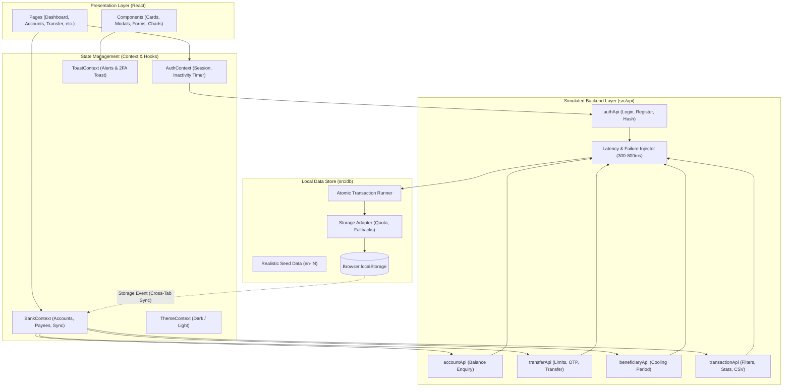

# NextBank — Modern Digital Banking Web Application

[](https://react.dev/)
[](https://www.typescriptlang.org/)
[](https://vitejs.dev/)
[](https://tailwindcss.com/)
[](https://recharts.org/)
[](https://vitest.dev/)
[](https://opensource.org/licenses/MIT)

> **NextBank** is a complete, fully functional, responsive demo banking web application designed to model everyday digital banking workflows. It is built as a learning project that simulates core banking workflows **without connecting to any real bank, payment network, server, or production database**.

All application data is simulated and persisted in the browser via `localStorage`, featuring a clearly separated **"Simulated Backend"** layer (`src/api/`) with artificial latency (300–800ms), typed errors, atomic transactions in integer paise (minor units), and cross-tab reactive synchronization.

---

## 📸 Key Features

### 1. Simulated Authentication & Session Security
- **Pre-seeded Demo User**: Instant 1-click login with pre-populated credentials via the **"Use demo account"** button.
- **Registration Flow**: Full name, email, phone, and real-time interactive password strength meter (evaluating lowercase, uppercase, digits, special characters, and minimum length).
- **Session Tokens & Inactivity Auto-Logout**: Generates session tokens with expiry. Tracks user activity across the DOM; if no activity occurs for 4 minutes 30 seconds, an **Inactivity Warning Modal** appears with a 30-second countdown. If 5 minutes elapse without interaction, the session terminates automatically with an alert.
- **Client-Side Hashing**: Passwords processed via SHA-256 client-side hashing (strictly for demo and learning purposes).

### 2. Dashboard & Financial Analytics
- **Personalized Greeting**: Dynamic time-of-day greeting (Morning, Afternoon, Evening) with verified customer status.
- **Total Balance & Masked Cards**: Visual cards for Savings and Current accounts with a toggle to reveal/hide account numbers (`•••• •••• 4756` ↔ `10029384756`).
- **Income vs. Expense Trend**: 6-month interactive area chart using **Recharts** showing monthly cash inflows against debits.
- **Category Spending Donut**: Interactive pie chart with color-coded categories (Salary, Rent, Food, Shopping, Utilities, Travel, Transfer, Investment).
- **Recent Transactions Ledger**: Quick view of the 5 most recent transactions with status badges and reference IDs.
- **Quick Action Bar**: Shortcuts for Send Money, Add Beneficiary, and View Statements.

### 3. Account Information & Live Balance Enquiry
- Complete account metadata: Account Type, Masked Number, IFSC Code (`NEXT0001001`), Branch (`Bandra West, Mumbai`), Status (`ACTIVE`), and Account Opening Date.
- **Balance Enquiry**: Real-time balance refresh with an animated loading spinner and "Last updated at" timestamp tracking.

### 4. Fund Transfers & Atomic Settlement
- **Multi-step Transfer Wizard**:
  1. *Transfer Details*: Select source account, choose a saved beneficiary or enter one-time payee details (Name, Account number, IFSC), input transfer amount, and add remarks.
  2. *Validation*: Real-time validation for positive amounts, minimum transfer (₹10.00), sufficient account balance, remaining daily limit, and beneficiary cooling status.
  3. *Review Screen*: Transparent breakdown of debited account, beneficiary details, fee (₹0.00), and net total.
  4. *Simulated 2FA OTP*: Generates a 6-digit numeric OTP delivered via an in-app Toast notification with a 1-click **"Auto-fill"** convenience button and a 120-second countdown timer.
- **Atomic State Updates**: Source account balance is debited, transaction logged, and if the beneficiary corresponds to an internal NextBank account, the recipient account is credited in the same atomic transaction.
- **Printable Payment Receipt**: Generates a clean receipt with Reference ID (`TXN-YYYYMMDD-XXXX`), status, and actions to print (`window.print()`) or download a text receipt.
- **Failed Transfers**: Unsuccessful attempts (e.g. invalid OTP, daily limit breaches) are recorded in the ledger with `FAILED` status and failure reasons.

### 5. Beneficiary Management & 30-Second Cooling Period
- Add, Edit, Delete, and Favorite/Unfavorite payees.
- Duplicate account number detection and IFSC format validation (`/^[A-Z]{4}0[A-Z0-9]{6}$/`).
- **Simulated 30-Second Cooling Period**: Newly created beneficiaries enter a `COOLING_PERIOD` status with a live countdown ticker. Transfers attempted during this window are guarded by a typed `CoolingPeriodActiveError` warning.

### 6. Transaction History, Filters & CSV Export
- Comprehensive transaction table with pagination (5, 10, 20, 50 rows per page).
- **Multi-parameter Search & Filters**: Search query (remark, reference ID, counterparty), date range picker, transaction type (`DEBIT`, `CREDIT`), category, status (`SUCCESS`, `PENDING`, `FAILED`), and amount ranges.
- **Column Sorting**: Sort transactions by date, amount, or category in ascending or descending order.
- **Transaction Detail Modal**: Slide-in modal with detailed transaction audit data.
- **CSV Export**: RFC 4180 compliant CSV generator with automatic browser file download.
- **Monthly Statement View**: Select month and year to inspect opening balance, total credits, total debits, closing balance, and itemized records with print functionality.

### 7. Profile, Settings & Demo Diagnostics
- Update personal profile (Name, Phone, Address).
- Change password with interactive criteria validation.
- Dark mode toggle (persisted in `localStorage` and synchronized with Tailwind's `dark` class).
- **Customizable Daily Limit**: Interactive slider configuring daily transfer cap between ₹10,000 and ₹2,00,000.
- **"Simulate Network Failure" Toggle**: Forces API calls to randomly throw `NetworkError` to demonstrate client-side error handling, alerts, and retry flows.
- **"Reset Demo Data"**: Restores seed accounts, 65+ transactions, and 4 beneficiaries with confirmation modal.
- **"Export My Data (JSON)"**: One-click download of the complete `localStorage` database.

### 8. Notifications Center
- Bell icon in the header displaying live unread notification counts.
- Popover listing in-app notifications generated by system actions (login, salary credit, transfers, new payees).
- Actions to mark individual notifications as read, mark all read, or clear notifications.

---

## 🏛️ Architecture & Simulated Backend

The application enforces a strict separation between the Presentation Layer, State Layer, Simulated Backend API (`api/`), and Persistent Data Store (`db/`). UI components never access `localStorage` directly.



---

## 💰 Integer Paise Financial Arithmetic

To eliminate standard JavaScript floating-point errors (e.g. `0.1 + 0.2 === 0.30000000000000004`), all balances and amounts are represented and calculated internally as **minor units (integer paise)**:

- `1 Indian Rupee (INR) = 100 Paise`
- **Internal Storage**: `balancePaise: 24585050`
- **Calculation**: Strict integer additions and subtractions.
- **Display**: Formatted via `Intl.NumberFormat('en-IN', { style: 'currency', currency: 'INR' })` yielding `₹2,45,850.50`.

---

## 🗄️ LocalStorage Database Schema

Stored under key: `nextbank_store_v1`

```typescript
interface DatabaseSchema {
  version: number;                  // Schema migration version (1)
  users: User[];                    // User profiles, client hashes, settings
  accounts: Account[];              // Savings and Current accounts with balance in paise
  beneficiaries: Beneficiary[];    // Payees with coolingPeriodEnd timestamps
  transactions: Transaction[];      // 65+ transactions across 6 months
  notifications: AppNotification[]; // In-app notification queue
  session: Session | null;          // Active authentication session token
}
```

---

## 🔑 Demo Credentials

| Role | Email | Password | Pre-seeded Balance |
| :--- | :--- | :--- | :--- |
| **Demo Customer** | `demo@novabank.com` | `Demo@1234` | ₹2,45,850.50 (Savings) + ₹1,12,400.00 (Current) |

> **Tip:** You can simply click the **"Use demo account"** button on the Login page to automatically fill these credentials.

---

## 🚀 Setup & Local Development

### Prerequisites
- Node.js (v18.0.0 or higher, Node v20/v22 recommended)
- npm or pnpm

### Quick Start
```bash
# 1. Clone the repository
git clone https://github.com/tirthrajmangoli1-jpg/nextbank-sdf.git
cd nextbank-sdf

# 2. Install dependencies
npm install

# 3. Start development server
npm run dev
```

Open `http://localhost:5173` in your browser.

### Running Automated Unit Tests
```bash
# Run all Vitest suites (API rules, transfers, limits, cooling period, UI components)
npm test

# Run tests in watch mode
npm run test:watch
```

### Production Build
```bash
# Compile TypeScript and bundle assets with Vite
npm run build

# Preview production build locally
npm run preview
```

---

## 🔄 Replacing the `api/` Layer with a Real Backend

Because all UI components interface exclusively with `src/api/*` and never communicate directly with `localStorage`, transitioning NextBank to a real cloud or microservice backend is straightforward:

1. **Replace API Implementations**:
   Replace the methods in `src/api/authApi.ts`, `src/api/transferApi.ts`, etc., with HTTP fetch calls (e.g., using `axios` or native `fetch`):
   ```typescript
   export const transferApi = {
     async verifyOtpAndExecute(req: VerifyOtpAndExecuteRequest): Promise<TransferResult> {
       const response = await fetch('/api/v1/transfers/verify', {
         method: 'POST',
         headers: {
           'Content-Type': 'application/json',
           Authorization: `Bearer ${getAuthToken()}`,
         },
         body: JSON.stringify(req),
       });
       if (!response.ok) {
         const errorPayload = await response.json();
         throw new BaseApiError(errorPayload.message, errorPayload.code, response.status);
       }
       return response.json();
     },
   };
   ```
2. **Move Security & Secrets to Server**:
   - Password hashing with bcrypt / argon2.
   - JWT or HttpOnly secure cookie issuance.
   - Two-Factor SMS/WhatsApp OTP delivery through Twilio/AWS SNS.
   - ACID transactional database locks (PostgreSQL `SELECT ... FOR UPDATE`).
3. **Remove `src/db/`**:
   Once backend microservices are connected, the client-side `src/db/` directory can be removed.

---

## ⚠️ Educational Disclaimer

This project is strictly for learning, portfolio demonstration, and educational purposes. It does not integrate with any real banking rails (NEFT/RTGS/IMPS/UPI) or card networks. Passwords and OTPs are simulated on the client side.

---

## 📄 License
MIT License. Built for educational demonstration.